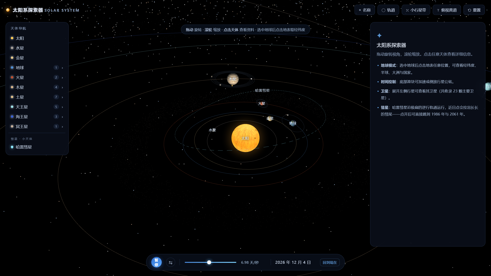
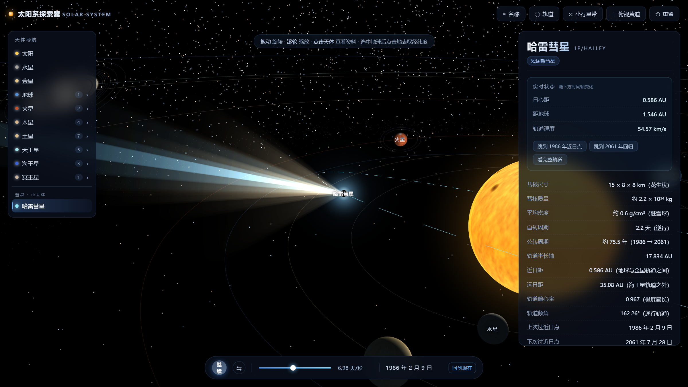
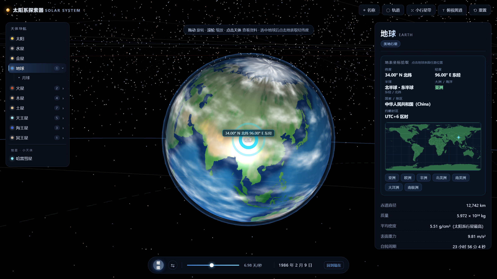

# 太阳系探索器 · Solar System Explorer

一个**纯前端、零依赖服务端**的 3D 太阳系交互网页。所有贴图都由代码实时生成，打开即用，不需要联网、不需要构建、不需要服务器。

👉 在线体验：**https://8888888b.github.io/solar/**



## 特性

### 3D 太阳系
- **真实轨道根数**驱动公转：J2000 历元的半长轴、离心率、倾角、升交点、近日点、平黄经，行星走的是真正的偏心椭圆（含逆行轨道）
- 太阳 + 八大行星 + 冥王星 + **23 颗主要卫星** + **哈雷彗星**，共 34 个天体
- 小行星带、柯伊伯带、14,000 颗程序化星空
- 拖拽旋转视角、滚轮/双指缩放、点击天体或左侧列表飞行聚焦
- 时间轴可从 0.01 天/秒加速到 5 年/秒，支持倒放与"回到现在"

### 程序化贴图（无任何外部图片）
| 天体 | 做法 |
| --- | --- |
| 地球 | Natural Earth 真实海岸线 + 纬度/内陆度驱动的生物群系（雨林、沙漠带、泰加林、苔原、极冠）+ 城市灯光 + 独立云层 + 自定义着色器（昼夜过渡、海洋高光、大气边缘光） |
| 气态行星 | 条带 + 湍流扰动，木星有大红斑，海王星有大暗斑与白色风暴带 |
| 岩质天体 | 陨石坑（含亮射线、跨贴图接缝补画）、月海、火星极冠、冥王星"心形"、土卫八双色、伊奥火山、欧罗巴冰裂纹 |
| 土星/天王星 | 半透明光环，含卡西尼缝与恩克缝 |

### 地球取点
选中地球后点击地表任意位置，即可读到：
- 纬度（南/北纬）、经度（东/西经）、南北半球与东西半球
- 大洲 / 海洋、国家 / 地区（Natural Earth 国界数据，222 个国家与地区）
- 约略时区，以及一张标出位置的小世界地图
- 七大洲快捷键：跳过去的同时自动把该点转到正午线，保证被太阳照亮

### 哈雷彗星
- 极扁的逆行轨道（e = 0.967，i = 162°），近日 0.586 AU、远日 35 AU
- 彗核 + 双层彗发 + **离子尾 / 尘埃尾**双尾系统，尾巴永远背向太阳，长度与亮度随日心距实时变化（近日点完全展开，远日点几乎熄灭）
- 面板实时显示日心距、地心距、轨道速度（活力公式）
- 一键跳到 1986 年与 2061 年两次回归：日期精确到当日近日点，r = 0.586 AU、v = 54.6 km/s





## 运行

```bash
# 方式一：直接双击 index.html（file:// 即可运行）
# 方式二：本地起个静态服务器（推荐）
python -m http.server 8080
# 打开 http://127.0.0.1:8080
```

在 URL 后加 `?hq` 可使用 4096×2048 的地球贴图（加载更久，适合大屏）。

## 目录结构

```
index.html          页面与全部样式
vendor/three.min.js three.js r147（本地内置，离线可用）
data/geo.js         Natural Earth 1:50m 国界与陆地轮廓（已简化）
js/data.js          太阳、行星、卫星、彗星的资料与轨道根数
js/textures.js      程序化贴图引擎（地球 / 气态 / 岩质 / 光环 / 光晕）
js/app.js           场景、轨道力学、相机、交互、UI
```

## 实现说明与取舍

- **比例不是真实的**：真实比例下地球只有 1 像素。距离按 `70·r^0.6`、半径按 `3.7·(R/6371)^0.41` 压缩，因此行星偏大、轨道偏近，但**相对大小与相对远近的次序保持不变**。
- **卫星只收录 23 颗主要卫星**（真实 200+），资料里注明了各行星的卫星总数。
- 轨道根数会随行星摄动缓慢变化，这里采用 J2000 瞬时根数，误差在几十年尺度上可忽略；哈雷彗星的周期取 1986→2061 的实际回归间隔。
- 贴图分辨率为加载速度做了取舍，首次加载约 5~10 秒（有进度条）。

## 数据来源

- 国界 / 陆地：[Natural Earth](https://www.naturalearthdata.com/)（公有领域）
- 轨道根数与天体参数：NASA JPL、IAU、各天体的公开资料

## License

[MIT](LICENSE) © 8888888b
